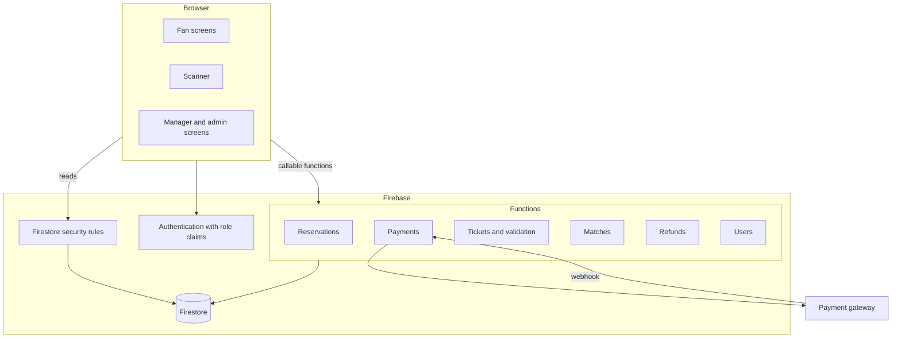
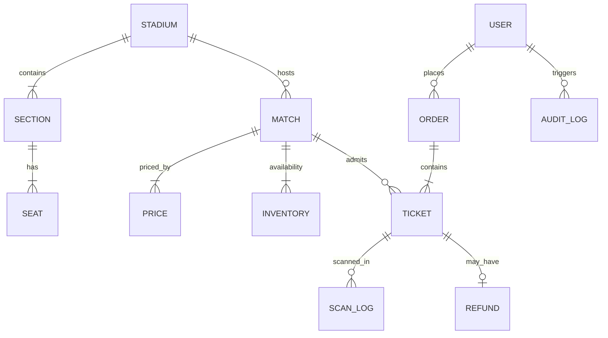

# Architecture, ERD and schema

## 1. Style: serverless on Firebase
Trusted logic (seat holds, payment confirmation, QR signing, validation, refunds) runs in Cloud Functions. The React app never writes business data directly.

Why: match-day load is bursty and serverless scales automatically; Firestore gives live updates; the emulator makes everything testable offline; one language end to end suits a small team.
Trade-offs: NoSQL data is denormalised; there is vendor lock-in (reduced by the PaymentGateway interface and repository classes); cold starts add latency.
Rejected: a Node and SQL monolith (more infrastructure work), microservices (too heavy for the scope).

## 2. Component diagram

## 3. ERD

## 4. Firestore schema (collections)
Schema script: functions/scripts/seed.js. Rules: firestore.rules. Indexes: firestore.indexes.json.
Design decisions: one inventory document per seat per match lets a transaction lock exactly the seats requested; money is stored in integer kobo; only Cloud Functions write orders, tickets, payments, refunds and stats.

## 5. Design patterns
| Pattern | Problem | Where |
|---|---|---|
| Strategy | Payment providers differ and tests need a fake | functions/src/payments (PaymentGateway, PaystackGateway, MockGateway) |
| Factory | Choose a provider from configuration, fail loudly if misconfigured | functions/src/payments/index.js |
| Repository | Keep Firestore calls out of business logic | tickets/FirestoreTicketRepository.js |
| Observer | The UI updates live when data changes | web/src/hooks/useLiveQuery.js |

## 6. SOLID module: ticket validation
- Single responsibility: TicketSigner signs, TicketValidator orchestrates, each rule checks one thing, repositories only store.
- Open/closed: new checks are new rule classes added to the rules array.
- Liskov: any repository with the same methods (including test fakes) can replace the Firestore one.
- Interface segregation: the validator needs only findById, markUsedIfValid, record and verify.
- Dependency inversion: TicketValidator receives its collaborators through its constructor and never imports Firebase.
Files: functions/src/tickets/.

## 7. Wireframes
Key screens are the running application; see screenshots/. Add Figma or hand-drawn sketches here if your course requires pre-build wireframes.
