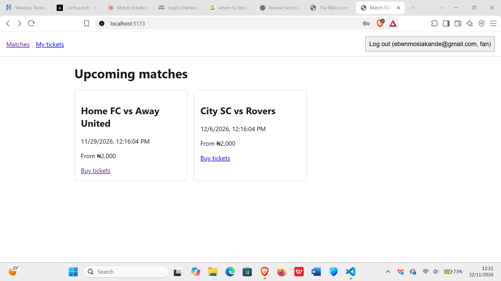
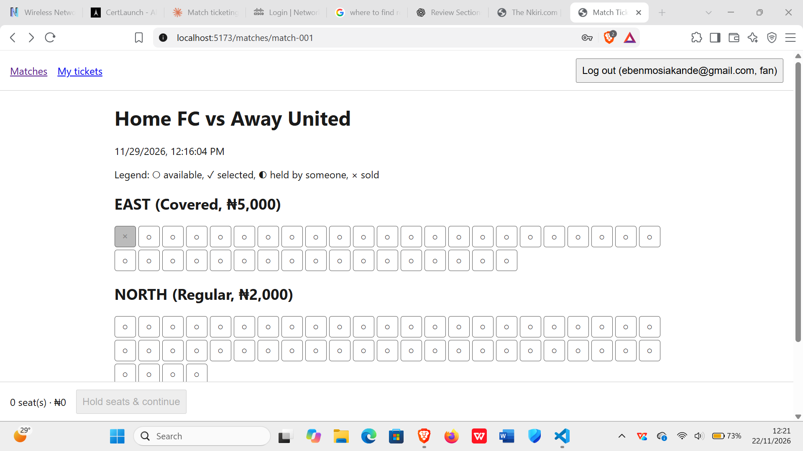
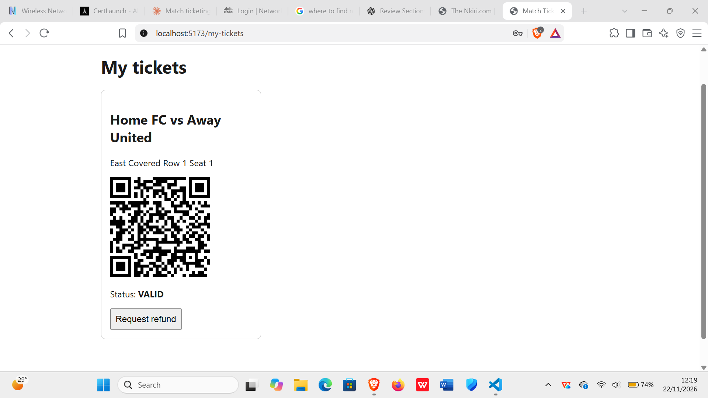
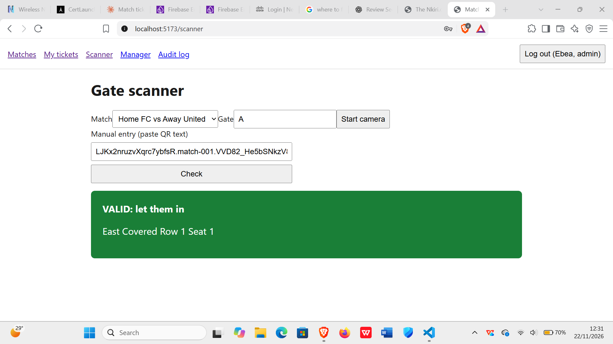
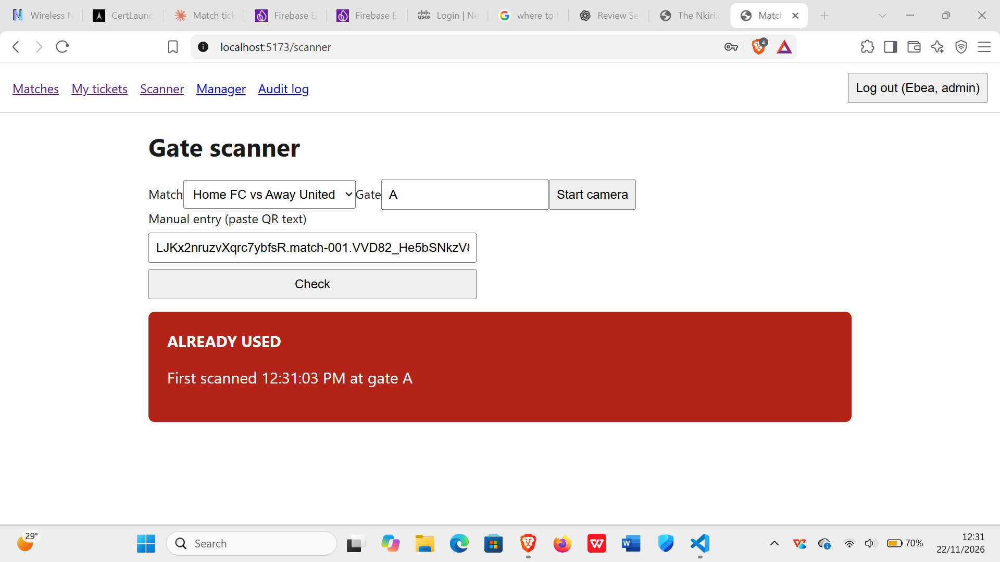
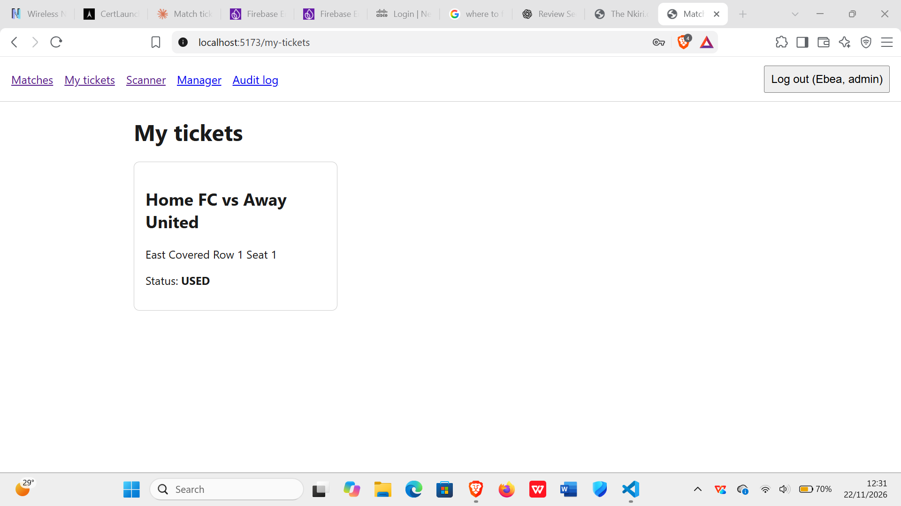

# Evidence: working prototype (22 November 2026)
Tester: Akande Ebenmosi Treasure | Browser: Brave | Environment: local Firebase emulators (project demo-mtses)

## 1. Browse matches (FR-06, US-02)

Two matches are on sale, each showing the lowest price.

## 2. Choose seats (FR-07, US-03)

Seats are grouped by section with category and price. The first East Covered seat is already sold (x), which is the seat bought in the test.

## 3. Ticket issued (FR-11, FR-12, US-05)

After payment confirmation the ticket shows a unique signed QR code and status VALID.

## 4. Gate scan accepted (FR-13, US-06)

The steward scanner shows green VALID with the seat name.

## 5. Second scan refused (FR-14, US-06)

The same ticket is refused with the time and gate of the first scan (12:31:03 PM, gate A). This demonstrates one-time use.

## 6. Ticket marked used (FR-14)

The fan's ticket now shows USED and the QR code is no longer displayed.
